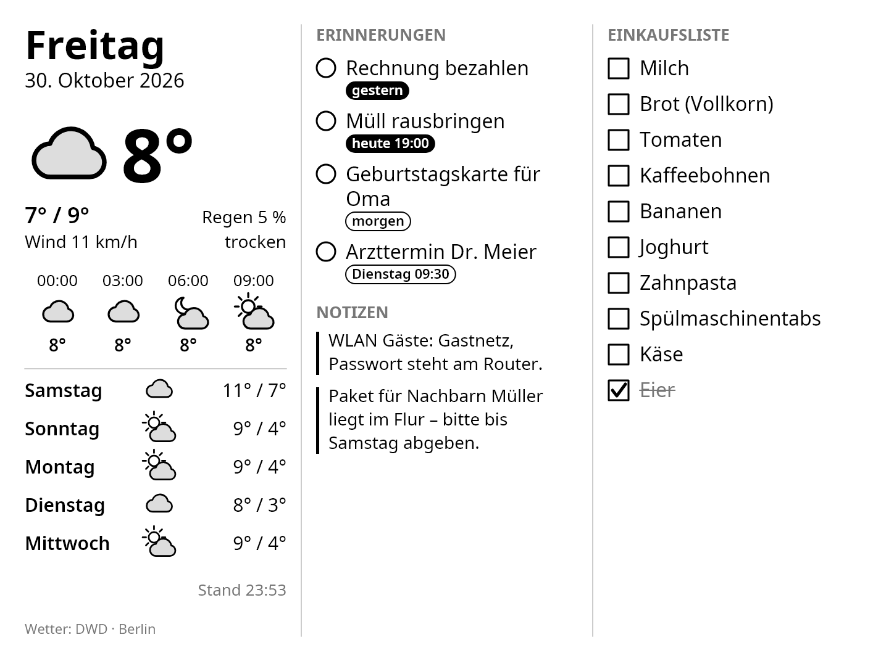

# Kindle dashboard

An old Kindle Paperwhite 3 as a dashboard on the wall: weather, reminders, notes and the shopping list, kept up to date
from anywhere with a phone. Items can be checked off right on the Kindle by tapping them.



*The picture of the Kindle in landscape (1448 × 1072, 16 grey levels), here with sample data.*

## How it fits together

```
 phone, anywhere                  your server (VPS)                          Kindle on the wall
┌───────────────┐   HTTPS    ┌───────────────────────────┐    HTTPS     ┌──────────────────────┐
│ web page      │ ─────────> │ ASP.NET Core application  │ <─────────── │ dashboard.sh         │
│ lists, place  │  password  │ data (SQLite), weather,   │ device token │ fetch picture, show, │
│ on a map      │            │ draws the picture, taps,  │              │ sleep until told,    │
└───────────────┘            │ wake-up times             │              │ taps after a button  │
                             └───────────────────────────┘              │ press                │
                                        │                               └──────────────────────┘
                                        └─> Bright Sky (DWD weather), OpenStreetMap services
```

- **The server does the work.** It keeps the data, fetches the weather, draws the complete picture and decides when
  the Kindle wakes up next. The Kindle only shows pictures and reports taps, so the layout can change without
  touching the Kindle.
- **The Kindle runs on battery.** It sleeps between updates (every 30 minutes by default, not at night, earlier when
  a reminder is due) with the light off. A press on the power button turns on the light and takes taps for a minute.
  On the charger it stays awake and updates within seconds.
- **The phone** uses a small web page behind a password: shopping list, reminders with date and time, notes, the place
  of the weather on an OpenStreetMap map, a preview of the picture and the Kindle's battery.

## What you need

- A **Kindle Paperwhite 3** (7th generation) with a firmware that can be jailbroken. Other models should work with
  small changes, see the [Kindle README](kindle/README.md#other-kindle-models).
- A **server** that is reachable from the internet with a domain and HTTPS, e.g. a small VPS with Ubuntu 24.04. The
  server part needs very little (it runs well on one CPU core).
- Wi-Fi where the Kindle hangs.
- Optional: a 3D printer for the mount (follows).

## Setting it up

1. **[Server](bummsn.de/README.md):** install the ASP.NET Core application behind nginx, set the password and create a
   device token for the Kindle.
2. **[Kindle](kindle/README.md):** jailbreak it (WinterBreak2), copy the client, enter the server URL and the token,
   start it.
3. **Phone:** open the web page, log in, choose the place for the weather, add items.

Each README goes through every step, from a Kindle in factory state and an empty server to the running dashboard.

## Repository

| Folder | Content |
|---|---|
| [`bummsn.de/`](bummsn.de/README.md) | server: ASP.NET Core 10, SkiaSharp, SQLite; [API](bummsn.de/API.md); deployment (systemd, nginx). Named after the author's server, nothing depends on the name. |
| [`kindle/`](kindle/README.md) | client for the Kindle (`sh` and `awk`), the start scriptlet, diagnostic scriptlets |
| `docs/` | pictures for the documentation |
| `mount/` | 3D-printed mount for a door, OpenSCAD (follows) |

## Status

Working: server, web page, Kindle client with sleep, wake-up by the power button, taps and the exit gesture.

Planned:

- a mount for the door, to slide the Kindle in from the side, held by removable adhesive strips (OpenSCAD),
- information and switches from Home Assistant through a small agent in the home network.

## Credits

- [KindleModding](https://kindlemodding.org) for WinterBreak2, KPM and the scriptlet support, and
  [FBInk](https://github.com/NiLuJe/FBInk) by NiLuJe, which draws on the Kindle's screen.
- [Bright Sky](https://brightsky.dev) for the weather data of the [Deutscher Wetterdienst](https://www.dwd.de).
- [OpenStreetMap](https://www.openstreetmap.org/copyright) contributors for the map, Nominatim for place names,
  [Open-Meteo](https://open-meteo.com) for time zones, [ipwho.is](https://ipwho.is) for the first guess of the place,
  [Leaflet](https://leafletjs.com) for the map on the web page.
- [SkiaSharp](https://github.com/mono/SkiaSharp) for drawing, and the [Noto Sans](https://notofonts.github.io) font
  (SIL Open Font License 1.1, see `bummsn.de/src/Dashboard/Fonts/OFL.txt`).

## License

Not decided yet.
