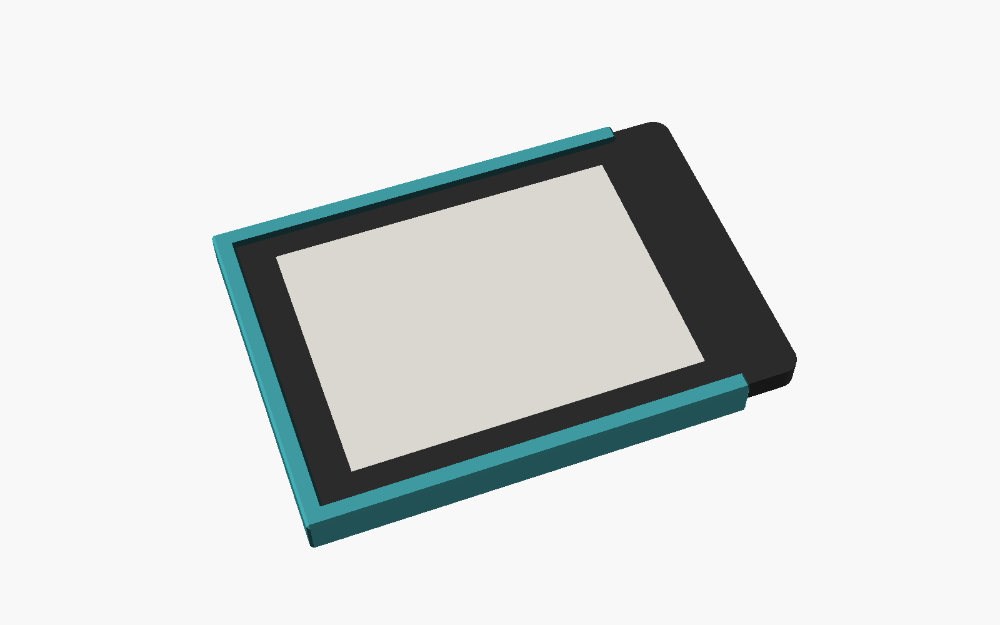

# Door mount

A 3D-printed mount for the Kindle Paperwhite 3, held on a door (or any smooth surface) by two tesa Powerstrips, which
come off again without leaving anything behind. The Kindle hangs in landscape and slides in and out on the right.



## Contents

- [How it is made](#how-it-is-made)
- [Printing](#printing)
- [Mounting](#mounting)
- [Taking it off](#taking-it-off)
- [Other Kindles](#other-kindles)

## How it is made

`kindle_mount.scad` is the whole model, every measure is a parameter (OpenSCAD: *Window → Customizer*).

- **A slot** that is closed at the top, the bottom and the left and open to the right. The Kindle sticks out 20 mm on
  the right, there you take hold of it. The power button and the USB port of the Paperwhite 3 are on that side when
  it hangs with the button on the right (the default of the server, `Orientation=ButtonRight`), so you can wake it up
  without taking it out.
- **Front lips** reach 5 mm over the bezel on three sides. The screen and the tappable areas stay free.
- **Two spring tongues** in the back plate press the Kindle lightly against the lips, with about 1.5 N each (calculated). It
  does not rattle, does not slide out by itself and still comes out easily. The back plate is thinner behind
  the tongues, so they can bend without touching the door.
- **The fields for the Powerstrips** are marked on the back, near the left and the right end, with the pull tabs
  hanging out below.

Outer size: 151 × 122 × 15 mm (length × height × depth).

The model is made for the Paperwhite 3 (2015, 7th generation): 169 × 117 × 9.1 mm, 205 g.

## Printing

Export the parts in OpenSCAD (*Design → Render*, then *File → Export → STL*) or on the command line:

```bash
openscad -D 'part="test"'  -o kindle_mount_test.stl kindle_mount.scad
openscad -D 'part="print"' -o kindle_mount.stl      kindle_mount.scad
```

Both parts are already standing on their closed left end. That way they print without supports, and the lips and the
tongues are as strong as they can be.

| | |
|---|---|
| Material | PETG (PLA works too, but creeps more under the springs) |
| Layer height | 0.2 mm |
| Walls | 4 |
| Infill | 30 % |
| Supports | none |
| Brim | 5 mm: the part stands 151 mm tall on a narrow base |

**Print the test section first.** It is the left end of the mount with one spring tongue and takes a fraction of the
time and material. Slide the Kindle in:

- It should go in with a little resistance and come out with a light pull. Too tight: lower `spring_bump` (or raise
  `clr_t`). Too loose: raise `spring_bump` by 0.2 mm at a time.
- Too tight or too loose from top to bottom: change `clr_h`.

Then print the whole mount with the same settings.

## Mounting

1. Choose the place. The Kindle needs Wi-Fi there, and the surface must be smooth and painted or lacquered:
   Powerstrips do not hold on wallpaper, plaster or raw wood. Try one strip on an out-of-sight spot of the door first.
2. Clean the place with alcohol (or a little dish soap and water, then let it dry). Grease keeps the strips from
   holding.
3. Stick two **tesa Powerstrips Large** (20 × 50 mm) on the back of the mount, into the marked fields, with the pull
   tab down and hanging out below the mount.
4. Take off the protective foil, put the mount on the door, level it and press it firmly for at least five seconds,
   over the whole field of each strip.
5. Wait an hour before you put the Kindle in. The strips hold best when they have set.

## Taking it off

Hold the mount and pull each tab slowly straight **down**, along the door, not away from it. The strip stretches and
lets go. Pulling it away from the door can tear the paint.

## Other Kindles

Change `kindle_l`, `kindle_h` and `kindle_t` to the size of your Kindle, print the test section and adjust the play
as above. Check where the power button is: it has to be on the open right side, because the dashboard needs it for
taps. In the closed left end you could not reach it.
